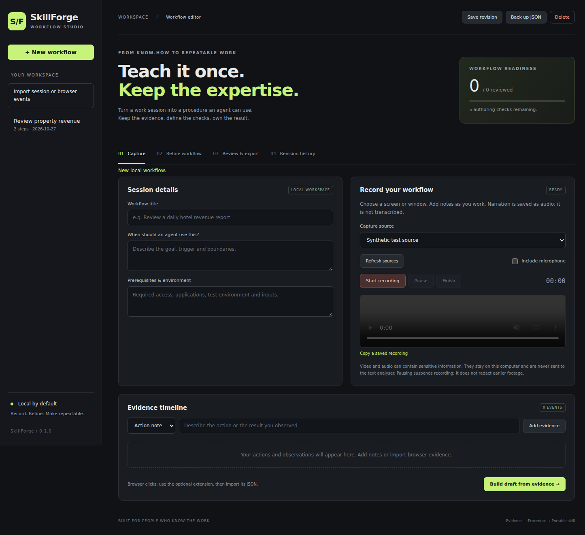

# SkillForge

**Capture the work. Keep the expertise. Export a procedure an agent can use.**

SkillForge is a local-first desktop workflow recorder and skill authoring studio by austugal. It records a selected screen or window, keeps timestamped evidence, and helps you turn that evidence into an editable, reviewed agent skill.

This is an independently implemented **v0.2.1 developer preview**, inspired by the record-to-skill idea in [Microsoft Skill Recorder](https://github.com/microsoft/skill-recorder). It is not a Microsoft product, a fork, or a benchmarked “10× better” claim. No upstream code is bundled.



Revision saves are serialized and ordered monotonically, including rapid saves within one millisecond.

## New in 0.2

- Review WebM/MP4 recordings locally, pause/seek and save timestamped JPEG frames.
- Inspect each frame and select which images a local vision model may receive. Text-only analysis stays the default; visual requests require the additional checkbox and a vision-capable installed Ollama model.
- Combine selected images (maximum 12 per request) with timestamped notes and click evidence. Generated steps must reference existing evidence and remain unapproved.
- Import existing SRT/WebVTT narration transcripts into the evidence timeline. This imports text; it does not perform speech recognition.
- Image files are session-local and are excluded from skill exports and JSON backups. Imported JSON cannot reuse local image references or image permissions.

## What works

- **Screen or window recording:** explicit source selection, optional microphone, pause/resume, local WebM storage. No global keyboard, clipboard or terminal hooks.
- **Evidence timeline:** timestamped notes and checkpoints, plus JSON import from the optional Chrome/Edge companion extension.
- **Workflow editor:** reorder steps, preserve evidence links, define expected results and recovery paths, flag consequential actions and approve each step.
- **Reusable inputs:** `{{parameter_name}}` placeholders with definitions; undefined parameters block export.
- **Optional local AI:** Ollama can suggest a workflow from text evidence. No paid AI subscription is required for manual authoring. Invalid model output cannot silently replace your work.
- **Revisions:** immutable local saves, changed-field comparisons and restore. Restore clears approvals.
- **Export gates:** incomplete, unreviewed or pattern-redacted workflows cannot export. Export includes the exact `SKILL.md` preview, structured `workflow.json` and a verification checklist.
- **Portable destinations:** generic skills, GitHub Copilot (`.github/skills`), Claude Code (`.claude/skills`) and Codex (`.agents/skills`). Install the exported folder in the relevant project after review.
- **CLI and CI:** validate/export session JSON without Electron; automated domain tests and JavaScript checks.

## Run on Windows

Install [Node.js 24 LTS](https://nodejs.org/) and Git, then use PowerShell:

```powershell
git clone https://github.com/austugal/skillforge.git
cd skillforge
npm ci
npm start
```

A private repository requires your normal GitHub authentication. macOS and Linux use the same commands; screen capture depends on OS permissions and, on Linux, the display server/portal. Windows is the intended first validation target. Native Windows capture has **not yet been verified on Tiago's computer**.

To package locally:

```powershell
npm run check
npm test
npm run dist -- --win
```

The **Build desktop packages** GitHub Actions workflow runs manually or when the package manifest changes on main and builds unsigned Windows, macOS and Linux artifacts. It does not publish a release. Unsigned builds may show OS trust prompts. Production signing and update delivery are not implemented.

## First workflow

1. Create a workflow with a title, use case and prerequisites.
2. Refresh sources, choose the window or screen and optionally enable your microphone.
3. Start recording. Add action notes and checkpoints as you work; pause before sensitive activity.
4. Finish. Build a draft from text evidence or use a locally installed Ollama model.
5. Replace example-specific values with parameters. Edit each action, verification and recovery path. Approve each reviewed step.
6. Open Review & export, approve the complete procedure and inspect the exact preview.
7. Export a fresh bundle. Test the procedure in a safe environment using the included checklist before operational use.

Recordings are saved separately from skill bundles. **Copy a saved recording** opens a picker for the current session's WebM files. **Back up JSON** exports workflow text and evidence, not video. Imports receive a new session ID and require a fresh review.

## Browser evidence extension

In Chrome or Edge, open the extensions page, enable developer mode, choose **Load unpacked** and select this repository's `extension` folder. Open an ordinary HTTP/HTTPS page, click the SkillForge extension, then **Start current tab**. Finish with **Stop & export JSON**, then import that JSON in the desktop app.

Capture is opt-in and limited to the injected document in the selected tab. It records button/link labels and the current origin/path; it does not read form values, screenshots, cookies, clipboard, network traffic or other tabs. After navigation, stop/export and start a new capture. Browser session storage holds the temporary capture and is cleared when the browser closes. URL paths and labels can still reveal private data: inspect imports. This is an unpacked development extension, not a browser-store release.

## Local AI

Install [Ollama](https://ollama.com/), download a local model (for example `ollama pull qwen2.5:7b`), and keep Ollama running. Enter its installed model name in the editor and select **Suggest steps**.

The application posts redacted text evidence, plus explicitly selected images when visual analysis is enabled, to `http://127.0.0.1:11434/api/chat`, without redirects. It does not send full video/audio, connect directly to a cloud model, install models or execute generated actions. Your Ollama configuration controls how the named model runs; choose a local model if you require offline processing. Model suggestions remain unapproved and must cite existing event IDs.

## Privacy and limitations

- Sessions, revisions and recordings live under Electron's per-user application data directory (`SkillForge`/`skillforge-studio`, depending on platform). They are ordinary local files, **not encrypted by the app**.
- Text is normalized and scanned for common token, credential and email patterns when imported, saved, analysed and exported. **This is pattern matching, not complete PII detection.** Redacted material blocks skill export until you remove or parameterise it.
- **Screen pixels, selected images and microphone audio are not redacted.** Record only appropriate material. Pause before entering secrets. Pausing cannot remove earlier footage. Delete a session to remove its saved revisions and recordings; OS backups may retain copies.
- Analysis uses text evidence and optionally selected frames. It does not continuously understand a video, transcribe audio, infer terminal commands or track arbitrary desktop clicks/app switches. Actual vision-model accuracy has not been benchmarked. Use the local video reviewer to choose evidence; review all model suggestions.
- No automatic replay, scheduling, cloud AI, Copilot SDK integration, API discovery, GitHub publishing from inside the app or enterprise policy management is claimed in this version.
- Export validation proves authoring completeness, **not factual correctness, authorization or replay reliability**. Approval markers do not grant an agent permission to make changes.
- Recording is bounded to 30 minutes / 500 MB. The app streams chunks to disk rather than holding a whole recording in memory. Save workflow revisions explicitly; closing asks before discarding unsaved work.

## Developer checks

```sh
npm ci
npm run check
npm test
npm run test:ui
```

UI tests run the actual Electron app with isolated temporary data and mocked file dialogs; they do not establish native capture success. See [VALIDATION.md](VALIDATION.md) for the OS acceptance checklist and known test boundaries.

CLI (no Electron runtime required):

```sh
node src/cli.cjs lint path/to/session.json
node src/cli.cjs export path/to/session.json ./output codex
```

## Structure

| Component | Role |
| --- | --- |
| `src/main.cjs`, `preload.cjs` | Isolated desktop shell, narrow IPC, source selection, recording and file dialogs |
| `src/core.cjs` | Normalization, redaction, workflow checks and deterministic skill export |
| `src/storage.cjs` | Local session revisions and fresh export bundles |
| `src/analyzer.cjs` | Optional bounded Ollama text analysis |
| `src/renderer.js` | Recording controls, evidence, review and editor |
| `extension/` | Opt-in browser click evidence |
| `test/` | Automated domain, renderer and extension checks |

## Next milestones

1. Validate capture, microphone, pause/resume and packaged startup on Windows 11.
2. Add local speech transcription and benchmark actual vision-model accuracy on representative tasks.
3. Add typed condition/branch support and measured replay evaluations.
4. Add optional provider adapters and repository publishing with an explicit data preview.
5. Sign releases, add update delivery and test macOS/Linux native capture.

## Copyright and permissions

Copyright (c) 2026 Tiago Fitas. **All rights reserved.** Use, modification and redistribution require prior written permission, except as stated in [LICENSE](LICENSE). The instructions above are for the owner and separately authorised users; they do not grant a licence.

This notice does not revoke permissions for versions previously distributed under MIT. Third-party components retain their own licences. Generated skills remain under your control; each target agent's runtime and permissions still apply.

Frame files remain in the session until the whole session is deleted, including when their timeline entries are removed. Pause/seek and review carefully before selecting images for AI. For saved app recordings, use Copy a saved recording and open the copy in Review a recording.
